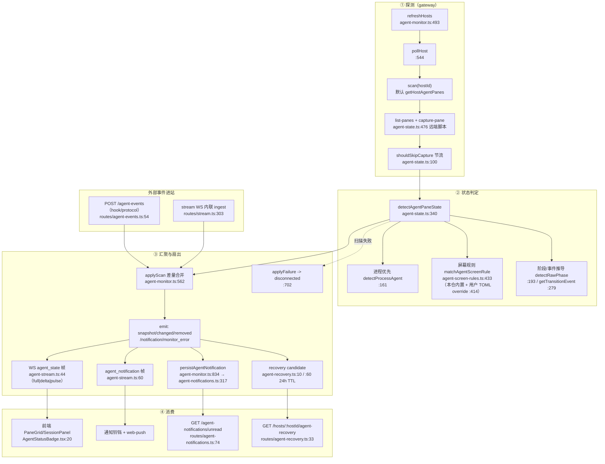

# agent 可观测 v2 蓝图

> 状态：设计稿（v1 已上线，v2 分期实施）
> 基线：master `e62c40d`
> 读者：改 agent 相关代码的人。所有断言都带 `file:line`，可按行核对。

## 0. 一句话

v1 解决「这个 pane 里的 agent 在什么状态」；v2 解决三个 v1 结构上答不了的问题：**pane 在干什么活（任务）**、**全机队现在长什么样（fleet）**、**哪些事等着我处理（待办）**。

三条硬约束贯穿全文：

1. **通道不新增**。远端一律 agent WS 优先、SSH 回落，与 tmux/git/文件/终端同一套语义（`lib/terminal-attachment.ts:106-120`、`lib/git-executor.ts:161-190`）。v2 只加语义，不加传输。
2. **冷热分离**。热路径是终端 stream；agent 状态是秒级冷数据，任务号更是分钟级冷元数据。v2 的任何新字段都不许进 stream 帧的必填路径。
3. **只读优先**。fleet / 待办先做只读聚合，写操作（批量 resume、批量 kill）留到 P3，且必须复用已有的动作端点（`routes/agent-recovery.ts:48`）。

---

## 1. v1 现状管线

### 1.1 数据流



### 1.2 三档轮询与空扫退避（决定了 fleet 面板能白拿什么）

- 档位：有监听者 → `intervalMs`（1.5s 快档）；无监听者但 web-push 订阅 → `pushPollMs`(5s)；都没有 → `idleMs`(30s)。`agent-monitor.ts:365-371`
- 空扫退避：连续空扫 2/5/8 轮 → 该 host 扫描间隔不低于 15/60/120s；扫到 pane 或扫描出错清零。`agent-monitor.ts:103-110`
- 唤醒：终端 attach 或协议事件进站时 `noteHostActivity` 清零档位并立即排扫。`agent-monitor.ts:429`、接线点 `lib/stream/stream-session.ts:1236` 附近
- **对 v2 的含义**：fleet 面板订阅 `agent_state` 会自然把 monitor 拉到快档——**面板开着就是快档，面板关掉自动回怠速，不需要 fleet 自带轮询**。这条是 v2 面板「零额外成本」的依据。

### 1.3 v1 的结构性缺口（v2 要补的）

| 缺口                                 | 现状证据                                                                                                       | v2 对策     |
| ------------------------------------ | -------------------------------------------------------------------------------------------------------------- | ----------- |
| pane 只有「状态」，没有「在做什么」  | `AgentPaneState` 无任务字段                                                                                    | §2 任务绑定 |
| 没有跨 host 的全局视图               | SessionPanel 按 host→session 树展开（`SessionPanel.tsx`），单 host 视角                                        | §3 fleet    |
| 通知是「事件流」，不是「待办」       | `InboxMessageType = text/image/video/file/link`（`types:791`），agent 通知另存 `agent-notifications`，两套存储 | §4 待办队列 |
| blocked 之后要不要人管，没有队列语义 | `agent_notification` 只带 pane 快照                                                                            | §4          |

---

## 2. 任务绑定规范：`@tmuxgo_task`

实施单：T-234（进行中）。本节定规范，实施按其验收。

### 2.1 为什么用 tmux user-option

| 方案                                   | 结论                                                                                                                                |
| -------------------------------------- | ----------------------------------------------------------------------------------------------------------------------------------- |
| **pane 级 user-option `@tmuxgo_task`** | ✅ 采用。随 tmux server 存续、pane 关闭自动消失、attach/detach 一致、远端可通过既有 `execTmux` 读写（远端通道已实证），不引入新存储 |
| gateway 侧 JSON 存储                   | ✗ 与 pane 生命周期脱钩，pane 被杀后留脏数据，还要自己做过期清理                                                                     |
| 写进 `pane_title`                      | ✗ 会跟 agent 自己的标题抢，且 `tmux rename-window` 类操作会覆盖                                                                     |

### 2.2 写方

两个写方，一条实现：

```
POST /panes/task
body { paneId: "host:%N", task: "T-234" }      // task 为空串 => 清除
```

实现要点（照 T-234 任务书）：

- 校验：`assertTargetAllowed(hostId, tmuxPaneId)`（远端同样生效，`routes/panes.ts:33` 起的同款调用）
- 写：`execTmux(hostId, ['set-option', '-p', '-t', paneId, '@tmuxgo_task', task])`
- 清：`execTmux(hostId, ['set-option', '-u', '-p', '-t', paneId, '@tmuxgo_task'])`
- 审计：沿用该路由既有审计惯例（`recordAuditRequest` 自动覆盖 POST，见 `lib/audit-log.ts`）

其它写方（后续）：

- tmux-comm / CLI：直接 `tmux set-option -p -t %N @tmuxgo_task T-234`，**不依赖 gateway**——这是选 user-option 的主要收益。
- agent 自身：agent 启动脚本可自报任务号，同样一条 set-option。

### 2.3 读方

- tmux 格式串：`sessions.ts:195`（session 视图的 list-panes）与 `sessions.ts:561`（
  window/pane 视图）两处 `-F` 串加 `#{@tmuxgo_task}`。
- 扩展检查：任何自己拼 `list-panes -F` 的路径都要补（`grep -rn "list-panes" apps/gateway/src`）。
- 前端：`Pane` 接口加 `task?: string`（`types/index.ts:113` 起，与 agentStatus 同款可选字段风格）。
- fleet 面板（§3）从同一处取数，不另开接口。

### 2.4 清除与生命周期语义

| 场景                | 行为                    | 说明                                               |
| ------------------- | ----------------------- | -------------------------------------------------- |
| 显式清除            | `set-option -u -p`      | 唯一「人为清空」路径                               |
| pane 关闭           | 随 tmux 自动消失        | 不需要 gateway 参与，也不会留孤儿                  |
| session/window 重建 | 不继承                  | user-option 是 pane 级（`-p`），新建 pane 默认无值 |
| 值格式非法          | 仍存原样，UI 只解析前缀 | gateway 不做语义校验，避免变成第二个真相源         |

### 2.5 格式约定

- 建议值：`T-234` 或 `T-234:pane 任务绑定规范`。
- UI 只渲染**第一个冒号前**的 id（chip 宽度可控），`title` 属性给全文。
- 不做强校验：外部写方（tmux-comm/手工）写 `fix-login` 也应正常显示，渲染层按「整串都是 id」兜底。

### 2.6 明确不做

- 不写 session/window 级 option（会造成继承污染，pane 全继承同一任务号）。
- 不把 task 塞进 `agent_state` 帧（热路径 + 冷元数据，见 §0 约束 2）；chip 从 pane 列表渲染。
- 不做任务号的唯一性/存在性校验（gateway 不认识 issue tracker）。

---

## 3. fleet 总览面板设计稿

### 3.1 目标与不做的边界

**目标**：一屏回答「现在哪些 agent 在跑、谁卡住了、各自在干什么活、我要不要介入」。

**不做**（v2 P1 内）：批量操作、新建 agent、编辑任务号、跨 host 拖拽。

### 3.2 数据源（全部已存在）

| 用途               | 来源                                                                        | 证据                                                                             |
| ------------------ | --------------------------------------------------------------------------- | -------------------------------------------------------------------------------- |
| 主数据（实时状态） | WS `agent_state` 帧：`full` 首帧 / `delta` 增量 / `pulse` 拥塞水位          | `lib/agent-stream.ts:44-58`，每连接一个 monitor listener：`routes/stream.ts:466` |
| 冷启动兜底         | `GET /hosts/:hostId/sessions?agents=1`（缺省行为不变，`agents=0` 才是精简） | `routes/sessions.ts:371-383`                                                     |
| 任务号             | 同上响应里 pane 的 `task`（T-234 后）                                       | §2.3                                                                             |
| 恢复建议           | `GET /hosts/:hostId/agent-recovery`                                         | `routes/agent-recovery.ts:33`；前端 `api.ts:706`                                 |
| host 列表          | `GET /hosts`（含 online 状态、connectionMode）                              | `routes/hosts.ts:60-73`                                                          |

**不新增接口**。fleet 面板是纯前端聚合：把已订阅的 `agent_state` 按 host 分组即可。

### 3.3 列定义

| 列             | 取值                                 | 备注                                                           |
| -------------- | ------------------------------------ | -------------------------------------------------------------- |
| Host           | hostId + online 点                   | 远端显示 `ssh` / `agent` 通道标记                              |
| Session / Pane | `sessionName` / `#{pane_index}`      | 点击跳转到该 pane（复用现有 select 动作 `routes/panes.ts:29`） |
| Agent          | `agent` 字段（codex / claude / …）   | 未知显示 `—`                                                   |
| 任务           | `pane.task` 解析出的 id              | 无值显示 `—`，不是空字符串                                     |
| 状态           | `AgentStatusBadge` 同款 tone/dot     | 复用 `components/AgentStatusBadge.tsx:20`，不重画              |
| 停留           | `since` → 相对时长（`12m`）          | 每分钟重算；不触发网络                                         |
| 最近事件       | `lastEvent` + `updatedAt`            | 用于「刚失败还是卡了很久」                                     |
| 动作           | 跳到 pane / 恢复（仅当有 candidate） | 恢复复用 `POST .../agent-recovery/:id/resume`（`:48`）         |

### 3.4 排序与过滤

- 默认排序：`blocked/permission`（需我处理）→ `failed` → `working` → `idle` → `unknown`，同状态内按 `since` 升序（卡最久的在前）。
- 过滤：host 多选、只看「需要我处理」开关（默认开）、只看有任务的。
- 搜索：任务号 / session 名 / agent 名，纯前端。

### 3.5 刷新策略

- **事件驱动**：订阅 `agent_state`（already the transport），收到 `delta` 只 patch 对应 pane。
- **兜底**：面板不可见时**不订阅**；可见且 30s 无帧时拉一次 `sessions?agents=1` 全量对齐（防丢帧）。
- **不做**：面板自带 `setInterval` 轮询 agent 状态。理由见 §1.2：订阅本身就把 monitor 拉到快档，再叠加轮询等于双重计费。
- 任务号变化不推送（冷数据）：面板可见时每 30s 顺带刷一次 pane 列表即可；pane 上的 chip 由所在列表刷新自然更新。

### 3.6 入口与布局

- **ActivityBar 新增 `fleet`**，排在 `sessions` 之后、`files` 之前。现有条目 id 顺序见 `components/ActivityBar.tsx:176-268`，目前没有全局 agent 视图。
- 为什么不塞进 sessions 面板：`SessionPanel` 的心智是「host → session → window → pane 的树」，fleet 是「扁平、跨 host、按状态排序」；两种排序同一棵树上打架。
- 图标：`FiCpu`（已 import 在该文件，用于 plugin 图标表）。
- 移动端：`lib/mobile-nav-items.ts:6-16` 的可选栏位白名单加 `fleet`，默认进「更多」。
- 未读/告警角标：fleet 图标显示 `blocked` 数量（不是总数），与 §4 的 `tasksBlocked` 同源。

### 3.7 空态与降级

- 全机队无 agent：给「本机还没有 agent pane，可先看 docs/architecture/agent-push.md 装 hook」。
- 某 host 扫描失败：该 host 分组头显示 `disconnected`（来自 `applyFailure` 的 pane 状态，`agent-monitor.ts:702`），不是整面板报错。

---

## 4. 待办队列设计（blocked / done / pending 聚合进 Inbox）

### 4.1 现状与问题

两套并行存储，用户要记两个地方：

| 存储                  | 承载                                                                                     | 证据                                                                 |
| --------------------- | ---------------------------------------------------------------------------------------- | -------------------------------------------------------------------- |
| `agent-notifications` | agent 状态通知（permission/question/completed/failed/ended/disconnected），web-push 同源 | `lib/agent-notifications.ts:317`、`routes/agent-notifications.ts:74` |
| `inbox`               | 助手/用户消息（text/image/video/file/link）                                              | `types:791`、`routes/inbox.ts:87`、`stores/useInboxStore.ts:89`      |

而 InboxPanel 现有的过滤维度是「已读/未读」+ 时间范围（`components/InboxPanel.tsx:75,224`），**语义是消息**，装不下「这件事还等着我」。

### 4.2 数据模型（复用通知存储，不新开表）

在 `agent-notifications` 记录上加三个字段：

```ts
kind: 'todo' | 'info'          // 默认 'todo'；纯状态播报（如 retrying）落 info
todoState: 'pending' | 'blocked' | 'done'
task?: string                  // 写入时从 pane 的 @tmuxgo_task 快照过来（不做关联查询）
```

映射规则（来源是 `AgentPhase`，`lib/agent-state.ts`）：

| agent phase                                           | todoState             |
| ----------------------------------------------------- | --------------------- |
| `permission_required` / `question_required` / blocked | `blocked`（需人处理） |
| `working` / `retrying` / `idle`                       | `pending`             |
| `completed` / `ended` / `failed`（已终结）            | `done`                |

聚合规则：

- 以 `paneId` 为 key 合并：**同一 pane 的连续通知只留一条待办**，`todoState` 取最新，`updatedAt` 更新（通知本身仍可全量留存，供审计与回看）。
- pane 消失（`agent_status_removed`）→ 该 pane 的待办转 `done`，理由 `pane_closed`。
- 幂等：沿用既有 `eventId` 去重（`agent-notifications.ts:321`）。

### 4.3 UI 方案

- InboxPanel 顶部加**视图切换**：`Messages | Tasks`（一个切换器，不是给每个过滤维度加 tab）。
- Tasks 视图三段：
  1. **Blocked**（需要我处理）——默认展开，按停留时长降序，行内直接给「跳到 pane」。
  2. **Doing**（pending）——进行中，可折叠。
  3. **Done**（最近 50 条）——回看，可一键 archived。
- 行内容：任务号 chip（来自 `task`）· agent · session/pane · 状态点 · 停留时长 · 最近一句话（`message`）。
- 未读数拆分：`messagesUnread`（inbox 原有）+ `tasksBlocked`（待办里 blocked 数）。MobileNav 角标取两者之和，但抽屉里分开显示——否则「一条消息」和「一个 agent 卡住等人」权重不同却记同一个数。

### 4.4 迁移与兼容

- 一次性 backfill：现存 `agent-notifications` 记录 `kind='todo'`、`todoState` 按当前 phase 推导；由于映射是纯函数，可懒迁移（读时推导 + 首次写入落库），不需要停机脚本。
- 老客户端不受影响：加字段是增量，`GET /agent-notifications/unread` 语义不变（代码见 `routes/agent-notifications.ts:74`）；新增 `?view=tasks` 维度才返回待办形状。
- 保留两套「已读」语义的独立性：inbox 的 readBy 是按设备的（`lib/agent-push.ts` 注释提到 deviceId 复用），待办的「已处理」是全局的——**不要复用同一字段**。

### 4.5 风险

1. **未读数语义模糊**：不拆分就是「消息和告警记一个数」，用户会点开发现没新消息。方案里已拆成两个。
2. **待办堆积**：长跑 agent 每个 pane 一条，Done 段需要默认折叠 + 上限（50 条）+ 归档策略，否则面板越用越慢。
3. **跨端一致**：`todoState` 是 gateway 侧状态，多设备同时「处理」同一待办需要乐观并发（沿用 notifications 现有写入的单文件锁语义，不新引入）。

---

## 5. 路线图

| 阶段                    | 内容                                                           | 交付物                                                   | 验收口径                                                                                            | 不做                             |
| ----------------------- | -------------------------------------------------------------- | -------------------------------------------------------- | --------------------------------------------------------------------------------------------------- | -------------------------------- |
| **P0**（进行中，T-234） | 任务绑定 MVP：读 `@tmuxgo_task`、`POST /panes/task`、pane chip | 字段 + 路由 + chip + i18n                                | set-option 参数形状、名单外拒绝、空值 `-u` 清除、chip 有无渲染                                      | 批量设置、任务校验、fleet 联动   |
| **P1**                  | fleet 只读面板                                                 | 新 ActivityBar 入口 + 面板 + 事件驱动刷新                | 100 个 pane 不掉帧；面板关闭后 monitor 回怠速（可用 `getPollIntervalMs` 断言）；无 agent 时空态正确 | 批量操作、写任务号               |
| **P2**                  | 待办队列                                                       | `kind/todoState/task` 字段 + Inbox Tasks 视图 + 未读拆分 | 同一 pane 多条通知合并为一条；pane 消失转 done；老客户端 unread 不变                                | 跨设备并发编辑、任务系统双向同步 |
| **P3**（预留）          | 编排：按任务批量 resume/spawn                                  | 复用 `agent-control` 与 recovery resume                  | 动作全部走已有端点，不新增写通道                                                                    | 自研调度器                       |

阶段依赖：P1 只依赖 P0 的 `task` 字段（缺它就少一列，不阻塞）；P2 独立于 P1，可与 P1 并行；P3 需要 P1+P2 的数据模型稳定后再说。

---

## 6. 证据索引

| 主题                        | 位置                                                                                   |
| --------------------------- | -------------------------------------------------------------------------------------- |
| monitor 单例 + 通知落库接线 | `apps/gateway/src/lib/agent-monitor.ts:834`                                            |
| 三档轮询                    | `agent-monitor.ts:365-371`                                                             |
| 空扫退避阶梯                | `agent-monitor.ts:103-110`                                                             |
| 唤醒通道                    | `agent-monitor.ts:429`、`lib/stream/stream-session.ts:1236` 附近                       |
| 扫描与节流                  | `agent-state.ts:100`（shouldSkipCapture）、`:476`（远端扫描脚本）                      |
| 状态判定                    | `agent-state.ts:340`、`:161`（进程）、`:305`（屏幕规则命中）                           |
| 屏幕规则表与 override       | `agent-screen-rules.ts:433`、`:414`                                                    |
| 差量合并 / 失败             | `agent-monitor.ts:562`、`:702`                                                         |
| 帧定义                      | `lib/agent-stream.ts:44`（agent_state）、`:60`（agent_notification）                   |
| 通知持久化与查询            | `lib/agent-notifications.ts:317`、`routes/agent-notifications.ts:74`                   |
| 恢复候选                    | `lib/agent-recovery.ts:10,60`、`routes/agent-recovery.ts:33,48`                        |
| pane 列表格式串             | `routes/sessions.ts:195`、`:561`                                                       |
| Pane 类型                   | `apps/frontend/src/types/index.ts:113`                                                 |
| 前端 API 入口               | `apps/frontend/src/lib/api.ts:684`（通知）、`:706`（恢复）                             |
| ActivityBar 条目顺序        | `components/ActivityBar.tsx:176-268`                                                   |
| Inbox 过滤与类型            | `components/InboxPanel.tsx:75,224`、`types/index.ts:791`、`stores/useInboxStore.ts:89` |
| 徽标组件                    | `components/AgentStatusBadge.tsx:20`                                                   |

---

## 7. 自检（写完后核对）

- 每条 `file:line` 都按当前 master 逐行 `sed -n` 核对过；文件名省略 `apps/gateway/src/` 或 `apps/frontend/src/` 前缀时，看上下文区分。
- 本文不含任何真实主机名、IP、凭据；示例主机名统一 `devbox`、路径 `/home/user`。
- 与 T-234 任务书冲突时以任务书为准（本文的 §2 是规范意图，实施细节看单）。
